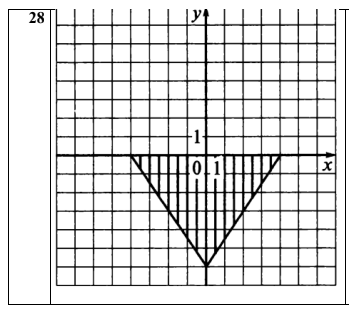
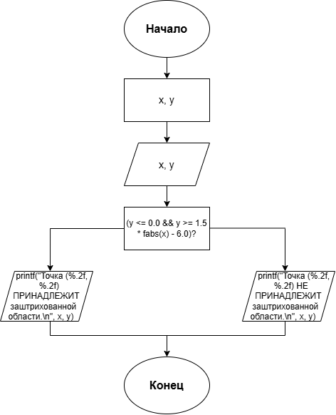

# Домашнее задание к работе 6
## Условие задачи
Составить программу, которая проверяет принадлежит ли заданная пользователем точка с координатами (х, у) заданным закрашенным (заштрихованным) областям, показанным на рисунках в табл., и выводит на экран сообщение.


## 1. Алгоритм и блок-схема
### Алгоритм решения
1. Начало
2. Объявить переменные:
   - координата x
   - координата y
3. Ввести значение переменной:
   - ввод значения x
   - ввод значения y
4. Вычислить логическое условие:
   - (y <= 0.0 && y >= 1.5 * fabs(x) - 6.0)
5. Вывести результаты расчетов с подстановкой всех значений в текст
6. Конец
### Блок-схема

## 2. Реализация программы
```
#define _CRT_SECURE_NO_WARNINGS
#include <stdio.h>
#include <locale.h>
#include <math.h>

int area()
{
    setlocale(LC_CTYPE, "RUS");

    double x, y;

    printf("=== ПРОВЕРКА ПРИНАДЛЕЖНОСТИ ТОЧКИ ОБЛАСТИ ===\n");
    printf("Введите координату x: ");
    scanf("%lf", &x);
    printf("Введите координату y: ");
    scanf("%lf", &y);

    printf("-------------------------------------------------------------\n");
    printf("Условие задачи:\n");
    printf("Треугольник с вершинами (-4,0), (4,0), (0,-6).\n");
    printf("-------------------------------------------------------------\n");
    printf("Исходные данные:\n");
    printf("x = %.2f\n", x);
    printf("y = %.2f\n", y);
    printf("-------------------------------------------------------------\n");
    printf("Результат:\n");

    if (y <= 0.0 && y >= 1.5 * fabs(x) - 6.0)
    {
        printf("Точка (%.2f, %.2f) ПРИНАДЛЕЖИТ заштрихованной области.\n", x, y);
    }
    else
    {
        printf("Точка (%.2f, %.2f) НЕ ПРИНАДЛЕЖИТ заштрихованной области.\n", x, y);
    }
    printf("-------------------------------------------------------------\n");

    return 0;
}

int main()
{
    area();
    getchar();
    getchar();
    return 0;
}
```
## 3. Результат работы программы
```
=== ПРОВЕРКА ПРИНАДЛЕЖНОСТИ ТОЧКИ ОБЛАСТИ ===
Введите координату x: 2
Введите координату y: -2
-------------------------------------------------------------
Условие задачи:
Треугольник с вершинами (-4,0), (4,0), (0,-6).
-------------------------------------------------------------
Исходные данные:
x = 2.00
y = -2.00
-------------------------------------------------------------
Результат:
Точка (2.00, -2.00) ПРИНАДЛЕЖИТ заштрихованной области.
-------------------------------------------------------------
```
## 4. Информация о разработчике
**Холодова Елизавета Юрьевна бИЦТ-262**
